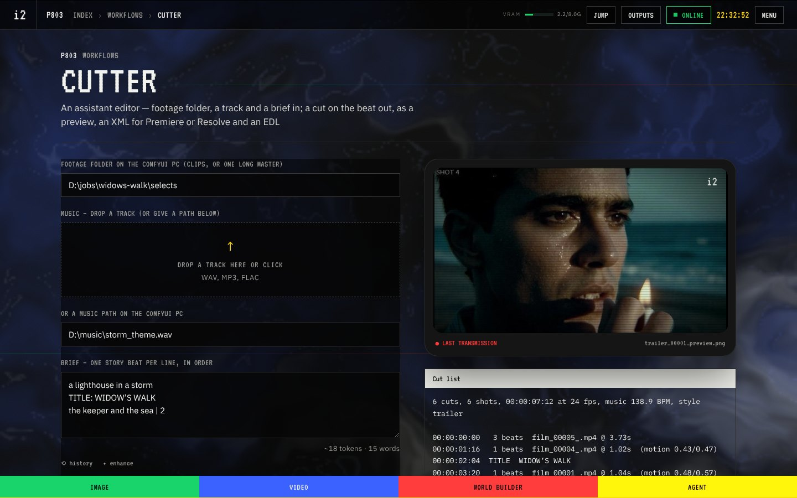

# i2 Cutter

**ComfyUI used as an assistant editor.** It doesn't generate a single pixel. You give it a folder of footage, a piece of music and a short brief, and it gives you back a cut on the beat as a **Premiere / Resolve sequence** that links to your original full-res media. You also get an EDL, a cut list and a preview MP4.

Built by i2 interactive LLC. MIT licence.

```
footage folder ─► i2 Footage Bin ─┬─► i2 Shot Scorer (CLIP) ─┐
                                  │                          ├─► i2 Cut Planner ─► i2 Timeline Export ─► .xml  .edl  .mp4
music file ────► i2 Music Map ────┴──────────────────────────┘
```

## Use it from the i2 Creative Hub

The [i2 Creative Hub](https://github.com/i2interactive/i2-creative-hub) (1.26 and newer) has this pack as the **Cutter** tool in its Workflows channel. Type the footage folder, drop a track (or type its path), write the brief and press Generate. The hub shows the preview, the storyboard and the cut list, with download links for the XML, the EDL and the cut-list JSON. If the pack is missing, the hub offers an Install button.



## What each node does

| Node | Does | Shows you |
|---|---|---|
| **i2 Footage Bin** | Reads every clip in a folder (or one long master). Splits files into shots, then measures each shot's motion and brightness and throws out black frames. The analysis is cached per file, so re-runs are instant. | A contact sheet of every shot |
| **i2 Music Map** | Finds the tempo, beats, bars and accents, plus an energy curve. No librosa needed. | A beat map: bars in white, accents in red, energy in yellow |
| **i2 Shot Scorer (CLIP)** | Scores every shot against every line of your brief with CLIP, running locally. A negative line pushes away things like text or logos. | The best shots for each line |
| **i2 Cut Planner** | Lays shots onto the beat grid, chapter by chapter. Quiet passages hold for whole bars; loud ones cut on every beat. Strong accents force a cut. It puts busy shots on loud passages, avoids repeats, and picks the best part of each shot. | A storyboard and the cut list, with the reason for every choice |
| **i2 Timeline Export** | Writes the FCP 7 XML, CMX 3600 EDL, cut list (JSON + TXT) and a preview MP4 with the music. | The preview video |

## Install

1. Copy the `ComfyUI-i2-Cutter` folder into `ComfyUI/custom_nodes/`.
2. Make sure `transformers` is installed. Most ComfyUI installs already have it; if not: `python -m pip install -r requirements.txt` with ComfyUI's Python.
3. Restart ComfyUI. The nodes are under **i2/cutter**.
4. Drag `workflows/i2_cutter_trailer.json` onto the canvas.

Paths can be full paths on the ComfyUI PC. A plain file name (or `input/song.wav`) is also looked for in ComfyUI's input folder, so files uploaded through ComfyUI or the hub work (1.0.1).

The first run of the Shot Scorer downloads the CLIP model into `ComfyUI/models/i2_cutter/`: about 1.7 GB for ViT-L/14, or 600 MB for ViT-B/32. After that it works offline. It runs on CUDA, Apple MPS or CPU, and it unloads after scoring so it doesn't hold VRAM.

## The brief

Write one story beat per line, in order. The cut moves through them from start to finish.

```
# comments start with #
a quiet stable at dawn, a horse breathing in the dark
a jockey alone, starving himself, a mirror, a scale | 1.5
TITLE: THIS NOVEMBER
the race, hooves, speed, a roaring crowd | 2
collapse, aftermath, an empty track at dusk
TITLE: WASTING | 2
```

- `| 1.5` sets a line's share of the running time relative to the others.
- `TITLE: words` makes a black title card lasting one bar (`| 2` = two bars). It becomes a gap plus a named marker in the timeline. The preview burns the words in so you can judge the timing.
- Every chapter boundary snaps to a bar line.

## Getting it into your NLE

- **Premiere Pro:** File › Import › the `.xml`. It arrives as a sequence with V1 (picture) and A1/A2 (music), plus chapter markers. The media links straight to your original files.
- **DaVinci Resolve:** File › Import › Timeline › the `.xml`. Untick "Automatically import source clips into media pool" if the clips are already there.
- The **EDL** is a fallback for anything else. Its reel names come from file names and every event carries `* FROM CLIP NAME`.
- Timelines start at 01:00:00:00. Source timecode is read from each file, so ProRes with embedded TC lines up.

## The NEEDS SHOTS marker

When more than half the cuts in a chapter only weakly match their line of the brief, the timeline gets a **NEEDS SHOTS** marker at that chapter. The cut list says which line it is. That's your list of what to generate or shoot next: drop the new clips into the folder and run it again. Only the new files get analysed.

## Settings worth knowing

- **style:**
  - `trailer`: cuts get faster as the piece builds.
  - `music video`: follows the music's loudness directly.
  - `montage`: an even pace.
  - `slow burn`: long holds.
- **min / max beats per cut:** the range of cut lengths. For a 128 BPM track, 1 to 8 beats means 0.47 s to 3.75 s.
- **seed** and **variety:** change the seed for a different version of the same cut.
- **allow_reuse:** lets a long shot (or a single film master) supply several cuts from different moments. They never overlap.
- **cut_sensitivity** (Footage Bin): raise it if fast cuts inside a master are missed. Lower it if camera moves get split.
- **source_audio** (Export): also lays each clip's own sound on A3/A4.
- **bpm_hint** (Music Map): set it if the detected tempo comes out at half or double.

## Limits

- Mixed frame rates work, but the XML expresses sources in the timeline's rate. Set `timeline_fps` to match your main footage.
- Shot detection catches hard cuts; dissolves are only partly detected. Use `handle_sec` to keep cuts clear of transitions.
- Variable-frame-rate phone footage and rotated phone clips haven't been tested.
- CLIP judges what a frame looks like, not performances or dialogue. Treat the cut as an assistant's first assembly.

## Tested

- Runs in ComfyUI 0.45 (frontend 1.59.4). The workflow loads in the real frontend and runs from it.
- **Beat tracking** on a 128 BPM test track came out at 128.01 BPM, with a mean beat error of 10 ms (a quarter of a frame at 24 fps). It found the correct bar phase, and accents were found at the crashes.
- **Shot detection** split a three-shot file at exactly 4 s and 8 s, dropped a black clip, and read embedded ProRes timecode (01:02:03:04 at 23.976).
- **The planner** was checked across 288 plans covering every style, reuse on and off, several beat ranges and seeds. Every plan:
  - covers the whole timeline with no gaps or overlaps;
  - cuts only on beats;
  - takes every source range from inside its shot;
  - never overlaps reused windows.
- **On a real machine** (2026-11-25, ComfyUI 0.46.3, RTX 3070 Ti, through the i2 Creative Hub): six short films in a folder and a 7-second soundtrack gave a 6-cut trailer at 138.9 BPM, with the TITLE card placed, in about 30 s. The XML, EDL and cut-list JSON were written next to the preview. CLIP matching was off for that run.
- **Not yet tested:** importing into Premiere and Resolve, and scoring with real CLIP weights. The scorer code path was run with a small stand-in CLIP model.

## Changes

- **1.0.1** (2026-11-25): plain file names for the footage and the music are also looked for in ComfyUI's input folder.
- **1.0.0**: first release.
